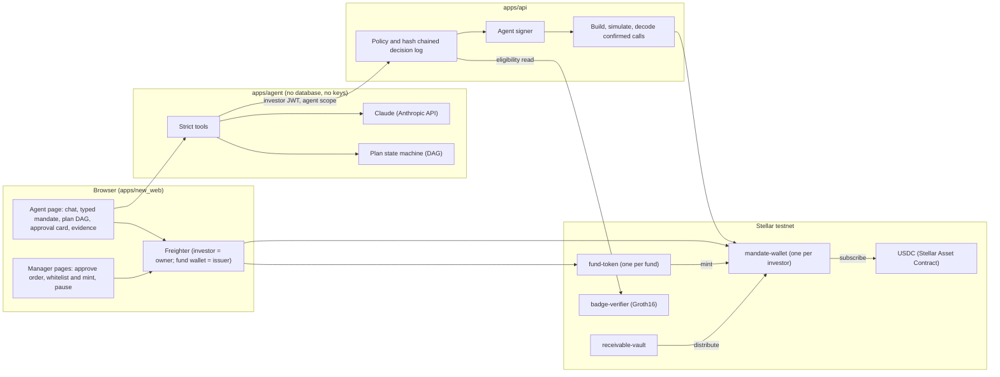
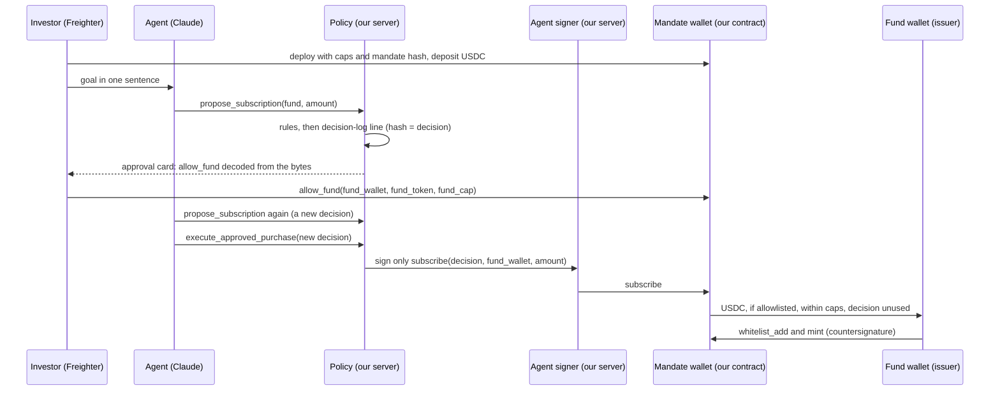

# How it works

Figure 1 shows the components and Figure 2 shows one first purchase in a new fund, from the investor's sentence to the issuer's mint. The steps below follow the order of a first purchase.

## Architecture

*Figure 1. Components. The agent service has no database and no keys; the agent key lives in the API's signer; the limits live in the mandate wallet contract.*

| Component | Responsibility |
|---|---|
| Agent page (`apps/new_web`) | Chat, typed mandate, plan DAG with the tier of each node, approval card decoded from the transaction bytes, pending and confirmed states, interrupt, recurring, revoke, evidence |
| Agent service (`apps/agent`) | Claude with ten strict tools, typed mandate, plan DAG, interrupt and resume, untrusted text marking, data minimisation before every model call |
| Policy and decision log (`apps/api/src/policy`) | Deterministic rules; mandate store the agent cannot write; append only log where `hash = sha256(prevHash || canonical(payload))`; an approval is valid for 15 minutes |
| Agent signer (`apps/api/src/agentSigner`) | One agent key per investor, encrypted at rest; signs only a `subscribe` identical to an approved decision |
| `mandate-wallet` | Fund allowlist; per purchase, per period and per fund caps; revocation; refusal of a reused `decision`; no upgrade function |
| `fund-token` | Fund units; allowlist of holders; mint only by the fund wallet; pause |
| `receivable-vault` | Receivables registry, `pay`, `distribute` pro rata to every holder |
| `badge-verifier` | Groth16 verification (BN254) of an investor tier proof |

## A first purchase, step by step

*Figure 2. First purchase in a new fund. Later purchases in the same fund skip the investor's `allow_fund`; the issuer still countersigns every mint.*

| Step | What happens | Who decides |
|---|---|---|
| S0 Mandate wallet | She deploys her own `mandate-wallet` (owner = her wallet, agent = an agent key generated for her, USDC, caps, mandate hash) and deposits test USDC | She signs |
| S1 Clarification | She writes her goal in one sentence; the agent asks only what is missing (residences, horizon, liquidity, maximum loss, amount, recurrence) and fills the typed mandate next to the chat | The agent proposes; nothing is valid until she approves |
| S2 Mandate anchored | The approved mandate hash goes on chain with the wallet deploy, or with `set_limits` if the wallet already exists | She signs |
| S3 Perimeter | A residence in Mainland China is refused by the rule `perimeter_mainland_china`; the reply names Yinfa [2026] No. 42 | Policy |
| S4 Screening and eligibility | Sector, largest debtor in %, liquidity, loss scenario; no return figure. Fund texts are marked untrusted. Tier funds need a zero-knowledge tier proof verified on chain; the agent only sees "eligible" or "not eligible" | Policy |
| S5 Quote | Units computed by code, rounded down, never above the amount asked | Code |
| S6 Correction | "Make it 500, only the agri fund" replans the DAG without starting over | Agent |
| S7 Proposal and decision | Policy checks perimeter, eligibility, destination (from our database, never from text) and caps, and writes a hash chained line; its hash is the `decision` | Policy |
| S8 First purchase in a new fund | The flow stops at the approval card (`allow_fund` decoded from the bytes, loss scenario, "The agent cannot change these limits."); a second decode in the browser blocks signing if it differs | She signs |
| S9 Agent purchase | The signer signs only the matching `subscribe`; our wallet contract checks allowlist, caps, revocation and reuse, then pays the fund wallet | Policy and our wallet contract |
| S10 Verification | The API decodes the confirmed transaction (contract, method, `decision`, destination, amount) before writing | API |
| S11 Issuer countersignature | The fund wallet signs `whitelist_add` (first time) and `mint` to her mandate wallet | Issuer signs |
| S12 Confirmation | "pending, not done" until the ledger closes; then hash and link; "awaiting issuer countersignature" until the mint | Network |
| S13 Recurring | "Run recurring now: pre-authorised within mandate" repeats S7, S9 to S12 for allowed funds, with a window to interrupt; no model decides it | Policy, contract, issuer |
| S14 Kill switch and freeze | She signs `revoke_agent()`; the issuer signs `set_pause(true)` | She; issuer |
| S15 Income back | A paid receivable is distributed by the vault to every holder, including her wallet ([`1a951aee...747d3b`](https://stellar.expert/explorer/testnet/tx/1a951aee3f1b529d9c5ada42302a53edf09ed5c24eca3b644a072e054d747d3b), 10 USDC) | Vault |
| S16 Evidence | One command recomputes the chain and compares every on-chain `decision` with its log line | Script |

## The agent

The agent service runs Claude (`claude-opus-5-5` by default) with ten strict tools: `get_mandate`, `propose_mandate`, `list_funds`, `get_fund`, `check_eligibility`, `quote_subscription`, `propose_subscription`, `execute_approved_purchase`, `get_status`, `get_holdings`. The plan DAG (profile, perimeter, eligibility, screening, proposal, investor signature, agent purchase, issuer countersign, confirmed) moves only on tool results, and each node shows its tier. The agent never says "done" before `get_status` reports a completed order. Third party text is passed as untrusted data and cannot set a destination or an amount: a value that does not come from the investor's messages or the mandate is sent to the policy as unverified and refused with a named rule.
